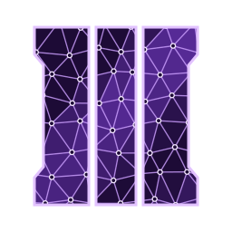

<div align="center">
    
    <h1>T7 DXBC</h1>
    <h3><em>Black Ops 3's compiled shaders, back to HLSL that compiles to the same shader.</em></h3>
</div>

<p align="center">
    <a href="https://github.com/McReaper/t7_dxbc/releases/latest"></a>
    <a href="https://github.com/McReaper/t7_dxbc/actions/workflows/ci.yml"></a>
    <a href="https://pkg.go.dev/github.com/McReaper/t7_dxbc"></a>
    <a href="LICENSE"></a>
    
    
</p>

<p align="center">
    <a href="#-install">Install</a> ·
    <a href="#%EF%B8%8F-use">Use</a> ·
    <a href="#-scope">Scope</a> ·
    <a href="#-how-it-is-checked">How it is checked</a> ·
    <a href="#-releases">Releases</a> ·
    <a href="#-license">License</a>
</p>

A pure-Go disassembler and decompiler for compiled Direct3D 11 shaders (DXBC), built for **Call of Duty: Black Ops III** (T7). It turns one of the game's compiled shaders back into HLSL that compiles to the same shader: the same constant buffers, resources and signatures, and code that computes the same results.

## 📥 Install

Download `t7dxbc` for Windows, Linux or macOS from the [latest release](https://github.com/McReaper/t7_dxbc/releases/latest), or build it with Go:

```sh
go install github.com/McReaper/t7_dxbc/cmd/t7dxbc@latest
```

For an AI agent, [T7 Companion](https://github.com/McReaper/t7_companion)'s `shader_decompile` tool runs it on the shader a material type uses.

## ⌨️ Use

```sh
t7dxbc disasm <shader>      # the instructions, as Microsoft's disassembler writes them
t7dxbc decompile <shader>   # HLSL
t7dxbc version
```

As a library:

```go
import "github.com/McReaper/t7_dxbc/hlsl"

src, err := hlsl.Decompile(compiled) // HLSL, or an error naming what isn't decompiled
```

| Package | What it holds |
|---|---|
| `dxbc` | the format: the container, reflection, signatures, instruction decoding, disassembly |
| `hlsl` | the decompiler |
| `cmd/t7dxbc` | the command |
| `internal/oracle`, `internal/sim` | the two oracles that judge a decompilation |
| `internal/d3dc`, `internal/genfixtures`, `internal/fixture` | Microsoft's compiler, the fixtures' build, their loading in tests |

The game's compiled shaders are under `share/assetconvert/shaders/pc/v7` in its mod tools.

## 🎯 Scope

Pixel, vertex, compute and geometry shaders in Shader Model 5 that keep their reflection: all 26,047 shaders in the game's mod tools are. The disassembly matches Microsoft's on every one of them. The `hlsl` package doc (`go doc ./hlsl`) lists what isn't decompiled (a shader stripped of its reflection, tessellation, doubles…) and the one difference left in what recompiles.

## 🔬 How it is checked

On Windows, with `d3dcompiler_47.dll`, each decompilation is compiled again and judged by two oracles: `internal/oracle` compares the interface an engine binds (reflection, signatures, declarations, barriers), and `internal/sim`, a CPU simulator of the instruction set, runs the original and the recompiled shader on the same random inputs. They judge:

- the fixtures in `testdata/`, HLSL written for this repository;
- random shaders generated as HLSL and compiled;
- opt in, a whole shader cache.

| Command | What it runs |
|---|---|
| `go test ./...` | every test; the oracles skip without the compiler |
| `go test ./hlsl -run TestDecompileGolden -update` | records the fixtures' decompilations after a change the oracles accept |
| `go run ./internal/genfixtures` | compiles `testdata/*.hlsl` (first line `// dxbc: <entry> <target>`) |
| `DXBC_CORPUS=<dir> go test ./dxbc -run TestCorpus` | the disassembly and reflection readers against Microsoft's, on a cache |
| `DXBC_CORPUS=<dir> DXBC_JOURNAL=<tsv> go test ./internal/sim -run TestCorpusAgrees -count=1 -timeout 0` | both oracles on a cache, resumable from the journal |
| `DXBC_ONE=<shader> go test ./internal/sim -run TestAgreeOne -v` | both oracles on one shader, logging its decompilation when they disagree |
| `DXBC_RANDOM=<n> go test ./internal/sim -run TestRandom` | more random shaders (`DXBC_RANDOM_SEED` to start elsewhere) |

A corpus run takes `DXBC_CORPUS_MAX_BYTES` (skip larger shaders) and `DXBC_WORKERS` (parallel compiles): recompiling one of the largest compute shaders takes up to 2.3 GB of memory.

Run `git config core.hooksPath .githooks` once per clone: the pre-commit hook runs gofmt and golangci-lint (`.golangci.yml`). The rules for changing the code are in `AGENTS.md`.

## 🚀 Releases

A `v*` tag on main releases: CI runs again on the tag, the oracles included, then GoReleaser (`.github/goreleaser.yaml`) publishes the archives with a changelog of the `feat`, `fix` and `perf` commits. A `.github/release-notes/<tag>.md` committed before the tag goes on top of it.

```sh
git tag v0.1.0 && git push origin v0.1.0
```

## 📄 License

MIT. No shader from the game is in this repository: the fixtures are compiled from HLSL written for it. Third-party notices are in `NOTICE.md`.
